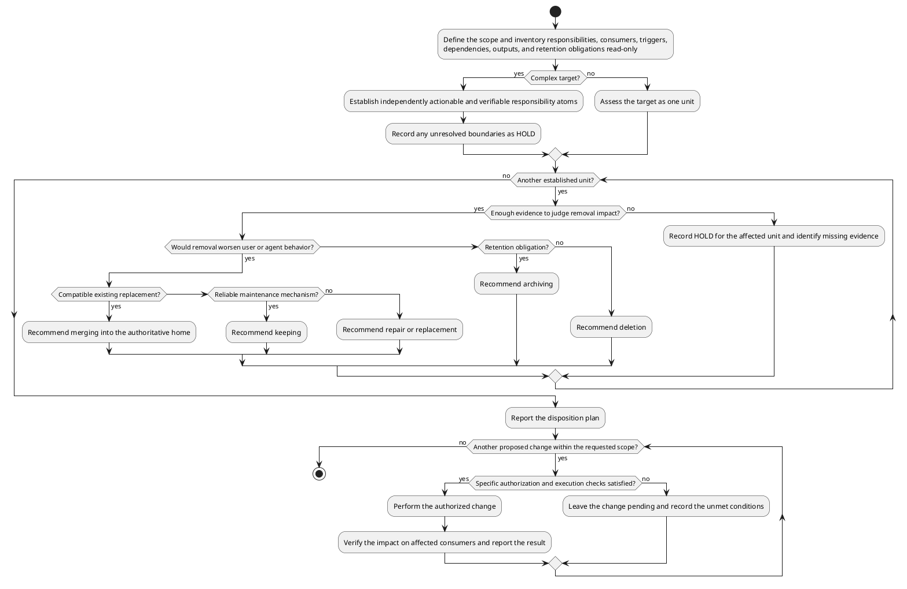

## Preparation

For a complex target, first read [Responsibility Atom](references/responsibility-atom.md) and produce a complete, non-overlapping decomposition into responsibility atoms that can be acted on and verified independently. Assess each established atom using the activity diagram below. Record unresolved boundaries as `HOLD`.

## Activity diagram

## Execution checks

Missing usage evidence does not prove that an item is unused. If a condition needed for a disposition is unresolved, record `HOLD` for the affected unit and continue assessing independent units.

For a review-only request, stop after reporting the plan. Before changing anything, confirm that the user's authorization covers the specific action and target, and verify the recovery method, retention obligations, and impact boundary.

An equivalent replacement must preserve compatibility for consumers, triggers, input contracts, and output semantics. For an authorized merge, migrate any unique value still in use and verify the replacement path before removing redundant material covered by the authorization.
